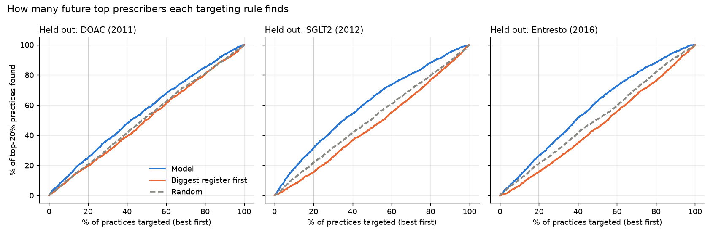
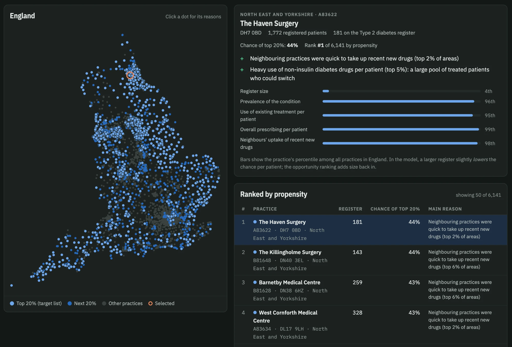
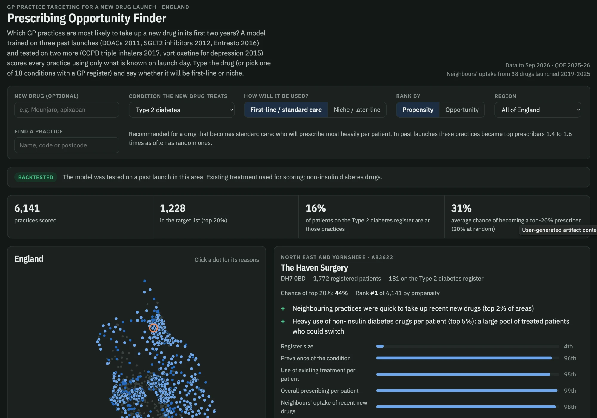

# NHS-targeting: which GP practices will take up a new drug?

A model that looks at every GP practice in England on the day a new drug launches and estimates which ones will
become its **strongest prescribers** two years later. It uses only public NHS data that would have been available on
launch day, and it explains each prediction in plain English.

## In one minute

* **The problem:** when a new medicine launches, a pharmaceutical company's launch team has to decide which of
  England's ~6,000 GP practices to visit first. Uptake is very uneven: two years after Entresto launched, nearly half
  of practices had still not prescribed it, while the top fifth were writing over 75 prescriptions per 1,000
  heart-failure patients every three months.
* **The data:** practice-level prescribing for every GP practice in England (113 months, 2010-2026, from NHS open
  data), plus each practice's patient registers for 18 conditions from the Quality and Outcomes Framework (QOF).
* **How it learns:** from three past launches: DOACs for atrial fibrillation (2011), SGLT2 inhibitors for diabetes
  (2012) and Entresto for heart failure (2016).
* **How useful is it?** Of the 20% of practices the model ranks highest, **28%** became top prescribers. A random
  choice gets 20%, and simply visiting the biggest practices gets **17%**, worse than random. On a launch it had never
  seen (COPD triple inhalers, 2017) it did better still: **32%**, i.e. 1.6× random.
* **The main findings:**
  * **Where a practice is matters most.** Practices whose neighbours were quick to take up earlier new drugs are the
    likeliest to adopt the next one. Local hospitals and area formularies shape uptake more than individual GPs do.
  * **Who is "best" depends on the goal.** The practices most receptive *per patient* are often small. Ranking by
    *expected volume* instead covers 39-47% of all prescriptions from 20% of practices.
  * **It works for drugs that become standard care, not niche ones.** On a third-line antidepressant, the per-patient
    ranking was no better than random, while the volume ranking still worked.
* **Honest by design:** features may only use what was known on launch day. Checking this caught a real leak, which
  was fixed (see *Keeping it honest*).



*How to read this chart:* each panel is one past launch that the model was **not** trained on. Moving right means
visiting more practices, best first. The higher the line, the more future top prescribers you have found. The blue
model line sits above random (grey dashed) in all three panels. "Biggest register first" (orange) is at or below
random.



*The tool for a new type 2 diabetes drug.* The map shows the top 20% of practices (light blue), the next 20% (dark
blue) and the rest (grey). On the right is the selected practice, its reasons and its percentiles, then the ranked
list.

---

## The problem

When a drug is launched, NHS GPs don't all start prescribing it at once. Some practices adopt it within months and use
it widely; others barely use it two years on. A launch team has limited people and time, so the question is:

> **On launch day, which practices should we prioritise?**

The obvious answer, "the biggest practices", turns out to be no better than random at finding the practices that
prescribe most *per patient* (17% vs 20%). This project tests whether public data can do better.

## How it works, step by step

**1. Collect the data.**
All the data is public NHS open data:
* **Prescribing:** how many prescriptions each practice wrote, for each drug, each month.
  * Aug 2010 – Dec 2013 comes from NHS Digital monthly files. Each is a 1.4 GB file, so it was streamed, filtered to
    the drugs needed, and deleted.
  * Jan 2014 onwards comes from the NHSBSA English Prescribing Dataset, queried through its SQL API so only the needed
    rows are downloaded.
* **Patients:** QOF registers, i.e. how many patients each practice has with diabetes, AF, COPD and so on, plus list
  sizes. This covers 11 years.
* **Practices:** region and location, from the NHS ODS files and postcodes.

Everything fits in about 1 GB on disk.

**2. Date each launch from the data.**
A licence date isn't when GPs start prescribing, so each launch is dated by the first month at least 10 practices
prescribed it.
* For DOACs, the data shows flat use (post-surgery only) until **Sep 2011**, then sustained growth after the AF
  licence.
* SGLT2s start in **Dec 2012** and Entresto in **Apr 2016**.

**3. Define success.**
A practice is a **top prescriber** if it is in the top 20% for new-drug prescriptions per 1,000 patients with the
condition, in months 22-24 after launch. Three months are used rather than one, to smooth out 28- vs 56-day
prescriptions.

**4. Decide what the model may use.**
Only facts known **on launch day**:
* number of patients with the condition, and prevalence
* how heavily the practice already uses the older drugs (the pool of patients who could switch)
* how much it prescribes overall
* how quickly **neighbouring practices** took up earlier new drugs

Each fact is converted to a percentile within the launch, so "top 10% for register size" means the same for AF as for
diabetes.

**5. Let the model learn.**
The model is a **logistic regression**: a weighted checklist of those facts. It was chosen over gradient boosting,
which did no better, because it can explain every score: each practice gets two or three sentences such as
*"Neighbouring practices were quick to take up recent new drugs (top 2% of areas)"*.

**6. Test it fairly.**
Each launch is hidden in turn, the model is trained on the other two, and it then scores the hidden one
(**leave-one-launch-out**). That rehearses the real situation: you have seen past launches, and a new drug arrives.

## What it found

**What makes a practice a likely top prescriber** (final model, standardised effect sizes):

| Factor | Effect | Plain English |
|---|---|---|
| Neighbours' uptake of earlier new drugs | **+0.22** | Areas that adopt new drugs quickly keep doing so: local formularies and specialists |
| Use of the older drugs per patient | **+0.17** | Lots of patients already treated means a big switching pool |
| Overall prescribing per patient | +0.15 | Practices that prescribe more in general |
| Prevalence of the condition | +0.04 | A small effect |
| Register size | **−0.11** | Bigger practices are slightly *less* likely to be top per patient |

**Location matters most.** As a diagnostic only (it uses the outcome, so it can't be a feature), how other practices
in the same area did predicts a practice's result with AUC 0.73-0.81. Regional differences are large: for DOACs,
**49%** of South West practices were top prescribers against **9%** in the North West.

**But the leading region changes from launch to launch** (South West for DOACs, North West for SGLT2s, Midlands for
Entresto). So a model that learns "region X is good" gets *worse* on the next launch. Region was left out, and local
effects come in through the neighbours' innovation feature, which does carry over.

## How good is the model?

**The simplest way to say it:** if a rep visits the model's top 20% of practices, about **28 in 100** become top
prescribers, against 20 with random visits and 17 with "biggest first". That's **1.4× random**, and it beat random in
every held-out launch.

| Approach | DOAC | SGLT2 | Entresto | Average |
|---|---|---|---|---|
| Random | 21% | 22% | 21% | 21% |
| Biggest register first | 20% | 16% | 16% | 17% |
| **Model** | **25%** | **32%** | **27%** | **28%** |

**The technical score: ROC-AUC = 0.60.** Pick one top prescriber and one other practice at random. The model ranks
the top prescriber higher **60 times out of 100**. Guessing scores 0.50.

**So what does that mean in practice?**
* **It's a useful edge, not a crystal ball.** At-launch data can't see the biggest driver, which is local hospital
  and formulary decisions.
* **It's a sorting tool.** Use it to decide where to start, then refresh once real prescribing appears.

### Two rankings: propensity and opportunity

The brief measured success **per patient**, which finds intense prescribers. But many of them are small, so together
the top 20% write only about 21% of a new drug's prescriptions. A sales team is paid on volume, so the tool offers two
rankings:

| Ranking | Became top prescribers | Share of all new-drug prescriptions |
|---|---|---|
| **Propensity** (chance of being top per patient) | 28% | 21% |
| **Opportunity** (propensity × number of patients) | 21% | **39%** |
| Biggest register first | 17% | 37% |

Which one is "right" is a business decision, not a technical one. Propensity suits early adopters and advocates;
opportunity suits sales coverage.

## Tested on launches it had never seen

The real test of a general tool is whether it works outside its training area. Two more launches were scored with
the model **frozen**: no retraining and no tuning.

| Launch | Ranking | Became top prescribers | Share of prescriptions | vs random |
|---|---|---|---|---|
| **COPD triple inhalers** (Trimbow/Trelegy, Sep 2017) | Propensity | **32%** | 22% | **1.6×** |
| | Opportunity | 30% | **47%** | 1.5× |
| | Biggest register first | 23% | 43% | 1.1× |
| **Vortioxetine for depression** (Dec 2015) | Propensity | 21.5% | 22% | 1.07× (no better than random) |
| | Opportunity | **27%** | **41%** | 1.4× |
| | Biggest register first | 25% | 37% | 1.2× |

* **COPD passed, and did better than the training launches.** It also ranks well *within* every region (AUC
  0.60-0.70), so it isn't just picking the right part of the country.
* **Depression was mixed, and the reason is the lesson.** Vortioxetine is a third-line drug, and **74%** of practices
  never prescribed it. "Top 20%" then mostly means "had at least one suitable patient", which depends on practice size.
  The per-patient model penalises size, so it fails; the volume ranking adds size back in and works.
* **The general rule:** the model predicts *how much* practices use a drug that becomes standard care. It doesn't
  predict *whether* they use a niche one. The tool turns this into a switch (see below).

Details: [reports/copd_backtest.md](reports/copd_backtest.md) and
[reports/depression_backtest.md](reports/depression_backtest.md).

## Keeping it honest

**1. No peeking at the future.**
QOF data comes out about 6 months after its year ends. A check on publication dates found that QOF 2010-11 was
published on **26 Oct 2011**, a month *after* the DOAC launch, so using it would have leaked the future. DOAC features
now use QOF 2009-10, and the build stops with an error if any feature uses data from the launch month or later.

**2. A leakage alarm.**
Each feature was checked on its own. A feature that predicted the outcome almost perfectly (AUC above 0.9) would
suggest a leak. None scored above 0.66, which fits genuinely pre-launch information.

**3. Testing on whole launches, not random practices.**
Splitting practices at random would let the model learn a launch's own quirks. Hiding whole launches is the honest
test of "will this work next time?".

**4. Being open about choices made after seeing results.**
The final 5-feature model was chosen after seeing held-out results, so its 28% is slightly optimistic. The 8-feature
model fixed in advance scores 27%, and both are reported. The COPD and depression launches were chosen *before*
scoring, and the model was frozen.

**5. Checking by hand.**
Sample rows were recomputed from the raw monthly data and match exactly.

## The tool

An interactive page (`reports/tool/index.html`) scores every current practice for a drug launching now. It uses QOF
2025-26 and prescribing from Oct 2025 to Sep 2026, built with the same at-launch rules as the backtests.

* **Type the drug** (generic or brand, e.g. "Mounjaro" or "apixaban") and it finds the condition(s) it treats. It
  knows 696 names. A name it doesn't know is flagged as probably brand new.
* **Or pick one of 18 conditions** with a GP register: diabetes, AF, heart failure, COPD, depression, hypertension,
  asthma, coronary heart disease, stroke, CKD, epilepsy, osteoporosis, obesity, dementia and others. Each is labelled
  *backtested*, *mixed* or *not validated*.
* **Say how it will be used:** *first-line / standard care* selects the propensity ranking; *niche / later-line*
  selects opportunity, as the backtests recommend.
* **Map** of ~6,100 practices, **ranked list** filterable by region, **reasons** for every practice, and **copy as
  CSV**.



It is one self-contained HTML file with the data built in: no server and no login. Open it in a browser or host it on
GitHub Pages.

## What it can't do

* **It can't see the biggest driver:** decisions by local hospitals and area formularies, which aren't visible on
  launch day.
* **It ranks; it doesn't forecast.** Scores are relative within England, not a number of prescriptions.
* **13 of the 18 conditions are not validated.** The model gives reasoned scores there, but hasn't been tested on a
  past launch in those areas. Conditions where specialists start the drug (dementia, rheumatoid arthritis, severe
  mental illness) are the main untested type.
* **Denominators are imperfect.** DOACs are also used outside AF, and Entresto suits only one type of heart failure.
  For some conditions the "existing treatment" drugs (e.g. statins) are used far beyond the registered patients.
* **Only five launches.** The direction is consistent, but the exact lift is uncertain.

## Try it yourself

You need Python 3.10 or newer on a Mac or Linux computer.

```bash
python3 -m venv .venv && .venv/bin/pip install -r requirements.txt
```

To **use the tool**, just open `reports/tool/index.html` in a browser.

To **rebuild everything from public data**, run these steps in order. The first download step takes about 1.5 hours;
the rest take minutes.

```bash
bash src/build_pre2014_manifest.sh > data/raw/pre2014_manifest.csv
python3 -I src/fetch_pre2014.py "$PWD"              # 2010-2013 prescribing (stream + filter)
python3 -I src/fetch_epd.py "$PWD"                  # 2014-2018 and latest 12 months
.venv/bin/python -I src/load_qof.py "$PWD"          # QOF registers (files listed in data/raw/qof_manifest.csv)
.venv/bin/python -I src/build_monthly.py "$PWD"     # one consistent monthly table
.venv/bin/python -I src/build_features.py "$PWD"    # features and target for each launch
.venv/bin/python -I src/train_model.py "$PWD"       # leave-one-launch-out testing, final model
.venv/bin/python -I src/backtest_launch.py "$PWD" copd
.venv/bin/python -I src/backtest_launch.py "$PWD" depression
python3 -I src/geocode_practices.py "$PWD"          # map coordinates
python3 -I src/find_recent_launches.py "$PWD"       # 2019-2025 launches, for neighbours' innovation today
python3 -I src/fetch_recent_uptake.py "$PWD"
python3 -I src/fetch_epd_extra.py "$PWD"            # prescribing for the extra conditions
python3 -I src/build_drug_lookup.py "$PWD"          # drug-name search
.venv/bin/python -I src/score_today.py "$PWD"       # today's scores -> reports/tool/index.html
```

---

## For the technically minded

| | |
|---|---|
| **Data** | NHS Digital practice-level prescribing Aug 2010 – Dec 2013 (presentation level, aggregated to BNF chemical); NHSBSA EPD Jan 2014 – Dec 2018 and Oct 2025 – Sep 2026 via the Open Data Portal SQL API; QOF practice prevalence 2009-10 to 2018-19 and 2025-26; ODS epraccur/epracarc; postcodes.io |
| **Unit** | GP practice × launch. GP practice = a code present in QOF (excludes out-of-hours services and walk-in centres, <1.5% of items) |
| **Launch date** | First month with ≥10 prescribing practices (class level; DOAC dated from the AF take-off, Sep 2011) |
| **Target** | Top 20% within launch of new-class items in months 22-24 per 1,000 register patients; register from the QOF snapshot nearest the window; practices with register <20, or closed by month 24, excluded. If >80% of practices have zero uptake, target = any uptake |
| **Features** | Within-launch percentiles of register size, prevalence, older-alternative items per 1,000 register (12 months pre-launch), total items per 1,000 list, and leave-one-out area mean of adoption speed (practice percentile of items per 1,000 list in the first ≤6 months of each earlier launch visible in the data, ≥100 practices at 12 months) |
| **Feature QOF year** | Latest *published* before launch (publication dates checked on NHS Digital) |
| **Models** | Logistic regression (final, 5 features, standardised); compared with 8-feature logistic, logistic + region dummies, `HistGradientBoostingClassifier` |
| **Validation** | Leave-one-launch-out over DOAC, SGLT2, ARNI (20,990 training rows); frozen-model backtests on COPD triple therapy (6,641 practices) and vortioxetine (7,034) |

**Results (held-out launch):**

| Model | AUC (DOAC / SGLT2 / ARNI) | Mean AUC | Precision in top 20% | Volume share in top 20% |
|---|---|---|---|---|
| Random | 0.52 / 0.51 / 0.51 | 0.51 | 21.3% | 20.4% |
| Biggest register | 0.50 / 0.46 / 0.45 | 0.47 | 17.0% | 37.4% |
| Logistic, 8 features (pre-specified) | 0.55 / 0.61 / 0.58 | 0.58 | 26.8% | 20.6% |
| Logistic + region | 0.57 / 0.57 / 0.56 | 0.57 | 25.0% | 19.1% |
| Gradient boosting + region | 0.54 / 0.58 / 0.57 | 0.56 | 25.8% | 20.9% |
| **Logistic, 5 features (final)** | **0.57 / 0.63 / 0.60** | **0.60** | **27.7%** | 20.6% |
| Final × register (opportunity) | — | — | 20.5% | **38.6%** |

Frozen-model backtests: COPD AUC 0.676 (precision 32.2%), depression AUC 0.515 (opportunity precision 27.3%, volume
41.2%).

Stage reports, with every number: [stage 1 data](reports/stage1_data_summary.md),
[stage 2 features](reports/stage2_features.md), [stage 3 model](reports/stage3_model.md),
[stage 4 tool](reports/stage4_tool.md).

## Project layout

```
src/             all code: downloads, loaders, features, model, backtests, tool builder
reports/         write-ups for each stage and backtest, charts in reports/figures/
reports/tool/    the tool: index.html (self-contained) and its template
models/          final_model.joblib (the trained model)
data/raw/        downloaded source files (not committed; rebuild with the steps above)
data/processed/  cleaned tables (not committed)
```

## Glossary

| Term | Plain meaning |
|---|---|
| **GP practice** | A local doctors' surgery; England has about 6,100 |
| **Launch** | When a new drug becomes available for GPs to prescribe |
| **Item** | One prescription for one drug |
| **BNF code** | The NHS code for every drug; its first digits say what it treats (e.g. 0403 = antidepressants) |
| **QOF** | Quality and Outcomes Framework: NHS data giving each practice's number of patients with each long-term condition |
| **Register** | The patients at a practice with a given condition, e.g. the diabetes register |
| **Prevalence** | Register size as a share of all the practice's patients |
| **DOAC / SGLT2 / ARNI** | Drug classes: blood thinners for AF; diabetes drugs; Entresto for heart failure |
| **Formulary** | A local list of approved drugs, often set by area or hospital committees |
| **Feature** | A piece of information the model looks at |
| **Target** | The answer the model learns to predict: top 20% prescriber or not |
| **Leakage** | Accidentally letting the model see information from after launch day |
| **Leave-one-launch-out** | Train on all launches but one, test on the one left out, repeat |
| **Backtest** | Scoring a past launch as if it were today, then checking what really happened |
| **Logistic regression** | A simple model: a weighted checklist of factors added up |
| **Gradient boosting** | A more complex model made of many small decision trees |
| **ROC-AUC** | How often the model ranks a real top prescriber above another practice. 0.5 = guessing, 1.0 = perfect |
| **Precision (top 20%)** | Of the practices the model would target, the share that became top prescribers |
| **Lift** | Precision divided by the random rate (20%): "×1.4 better than random" |
| **Propensity / opportunity** | Chance of being a top prescriber per patient / that chance × number of patients |
| **Percentile** | Where a practice ranks among all practices, e.g. 90th = higher than 90% |

## Next steps

* **A "month-3 refresh":** rescore practices using the first three months of real prescribing, which would likely
  predict much better.
* **Backtest a specialist-started drug** (e.g. dementia or rheumatoid arthritis), the one launch type not yet
  tested.
* **More launches to learn from:** 2019-2025 launches such as finerenone, inclisiran and tirzepatide.
* **Add deprivation and age profile** (from practice postcodes and list-size age bands).
* **A niche-drug model** that predicts "any uptake" for later-line drugs, trained on niche launches.

## How this was built

I built this project with **Claude** (Anthropic's AI assistant) as a coding and analysis partner, and I want to be
open about how the work was split:

* **My part:**
  * the question and the scope
  * the key decisions (the target definition, what counts as known at launch, how to validate, which ranking views
    to offer, which conditions to cover and test)
  * reviewing the results
* **Claude's part:** much of the code, the analyses and the write-ups, done under that direction.

The safeguards that make the results credible were deliberate parts of the process:
* publication-date leakage checks that stop the build
* leave-one-launch-out testing
* frozen-model backtests on launches chosen before scoring

## Data licence

Contains public sector information licensed under the
[Open Government Licence v3.0](https://www.nationalarchives.gov.uk/doc/open-government-licence/version/3/)
(NHSBSA, NHS England / NHS Digital). Postcode locations from postcodes.io: contains OS data © Crown copyright and
database right; contains Royal Mail data © Royal Mail copyright and database right; source: Office for National
Statistics, licensed under the Open Government Licence v3.0.
