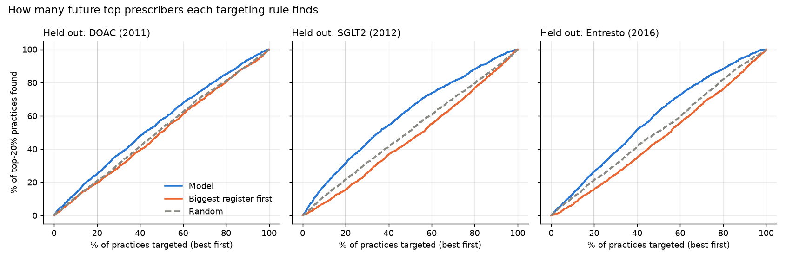

# Stage 3: Model and validation

*Run 21 Nov 2026 by `src/train_model.py`. Full output is in `reports/stage3_results.txt`. Held-out scores for every practice are in `data/processed/lolo_predictions.parquet`, and the final model is saved at `models/final_model.joblib`.*

## How it was tested

**Leave-one-launch-out.** I hide one whole launch, train on the other two, and score the hidden one, then repeat for each launch. That is a fair rehearsal of the real job: "we've seen past launches; now a new drug arrives." The hidden launch is never used for fitting, and settings were fixed in advance rather than tuned on it.

**What "good" means here.** The tool tells a launch team which 20% of practices to visit first, so the key question is: *of the practices we'd target, what share become top-20% prescribers?* Random targeting gets 20%.

## Results (on the hidden launch)

| Approach | DOAC | SGLT2 | Entresto | Average | vs random |
|---|---|---|---|---|---|
| Random | 21% | 22% | 21% | 21% | 1.0× |
| Biggest register first | 20% | 16% | 16% | 17% | **0.85×** |
| Logistic, all 8 features | 24% | 30% | 26% | 27% | 1.34× |
| Logistic + region | 26% | 26% | 24% | 25% | 1.25× |
| Boosted trees + region | 25% | 27% | 26% | 26% | 1.29× |
| **Logistic, lean 5 features (final)** | **25%** | **32%** | **27%** | **28%** | **1.39×** |

The figures are the share of targeted practices that turned out top-20%. AUC for the final model is 0.57 / 0.63 / 0.60 (average 0.60).

**In plain English:** if a rep visits the model's top 20% of practices, about 28 in 100 become top prescribers, against 20 with random visits and 17 with the "biggest practices first" rule. The model beats random in every held-out launch, including the hardest one (DOAC, where there was almost no history before launch).

## Why these choices

- **Logistic regression over boosted trees.** The trees did no better (26% vs 27–28%). With signals this weak, a simpler model generalises at least as well. Logistic also gives a clear "reason" for each practice, which the Stage 4 tool needs.
- **No region in the final model.** Adding region made results *worse* on the hidden launch, because which region leads changes from launch to launch: the South West for DOACs, the North West for SGLT2, the Midlands for Entresto. A model that learns "the South West is good" from DOACs would wrongly carry that across. Local area still enters through the neighbours' innovation score, which does transfer.
- **The lean feature set.** I dropped three features that made held-out results worse or no better in every launch: the practice's own adoption speed, and the area averages of older-drug use and total items. **Caveat:** I chose this after seeing the held-out results, so the lean figures are slightly optimistic. The pre-chosen 8-feature model (27%, 1.34×) is the strictly honest benchmark, and the gap is small.

## What drives a top prescriber (final model, all three launches)

| Feature | Effect | Plain English |
|---|---|---|
| Neighbours' innovation (`area_adopt_speed`) | **+0.22** | Practices in areas that took up earlier new drugs quickly are more likely to adopt the next one. This is the local formulary and specialist effect |
| Older-drug use per patient (`older_alt_per_1k_reg`) | **+0.17** | Lots of patients already treated the old way means a big switching pool and an engaged practice |
| Overall prescribing intensity | +0.15 | Practices that prescribe more in general |
| Prevalence | +0.04 | A small effect |
| Register size | **−0.11** | Bigger registers are *less* likely to be top-20% *per patient* (see below) |

These are standardised coefficients: the effect of a one-standard-deviation change on the log-odds, so they are comparable with each other.

## The big caveat: rate vs volume

The brief defines success as **items per 1,000 register patients**, which measures intensity. But a sales team is paid on **volume**, and the two point to different practices:

| Ranking | Share of top-20%-rate practices found | Share of total new-drug items from the targeted 20% |
|---|---|---|
| Final model (rate) | 28% | 21% |
| Biggest register first | 17% | 37% |
| Model score × register (expected volume) | 21% | **39%** |

- The rate model finds intense prescribers, but many are small practices, so together they write only about 21% of the drug's prescriptions.
- Ranking by model score × register keeps the model's insight while weighting by size. It captures 39% of total volume, slightly more than "biggest first" (37%).

**Interview point:** "the target definition is a business decision, not a technical one. I'd show both lenses: *propensity* (who is most receptive per patient, good for early adopters and advocacy) and *opportunity* (where the volume is)."

## Honest limits

- **The signal is modest:** an AUC of 0.60 and 1.4× random. At-launch data can't see the biggest driver, which is local hospital and formulary decisions. As a check that uses the outcome (so it can't be a feature), neighbours' results predict a practice with AUC 0.73–0.81.
- **Only three launches,** so each result rests on one example of "a new launch". The direction is consistent across all three, which is reassuring, but the exact lift is uncertain.
- **Natural next steps:**
  - a "month-3 refresh" that uses the first months of real uptake
  - deprivation (IMD) and practice age-profile features
  - more past launches (2019–2025 data, e.g. finerenone or inclisiran) to give the model more examples.
